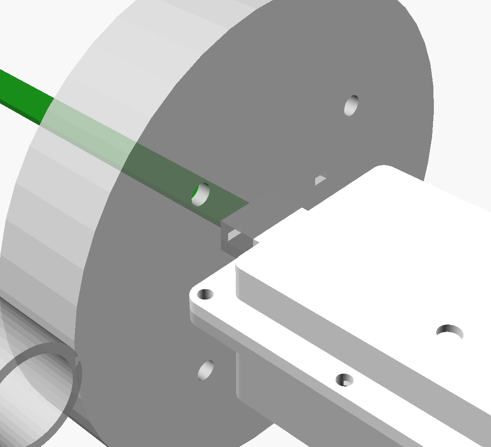

# AWD field node enclosure v0.1



The enclosure has three printed parts. The design source is `awd_enclosure.scad` (OpenSCAD); the print files are in `stl/`.

| Part | What it does | Size | Weight (ASA) |
|---|---|---|---|
| `front_shell.stl` | Covers the component side. The PAIR/BOOT button is pressed through a 0.7 mm flexible patch, and the LED shows through a 0.7 mm window. | 64 × 90 × 11 mm | ~19 g |
| `back_shell.stl` | The PCB rests on a ledge. A 1×AA holder (fits the LiFePO4 14500) sticks to the floor cradle. Nut pockets for 6 × M3. | 64 × 90 × 26 mm | ~31 g |
| `pipe_collar.stl` | Sits on the AWD tube rim (110 mm tube by default) so the strip hangs down the centre. Has air vents and a clip for a 20 mm conduit antenna pole. | 137 × 116 × 23 mm | ~56 g |

The weights assume solid parts, which is close to how 2.5 mm walls print.

## How it goes together

1. **PCB into the back shell:** the PCB drops onto the back-shell ledge. The SMA barrel goes through the half-hole in the left wall, and the strip goes out through the gland at the bottom.
2. **Battery:** plug the AA holder's JST lead into J3.
3. **Silicone in the groove:** run a bead of **neutral-cure silicone** (sold as "neutral" or "electronics grade") along the groove on the front-shell flange. Do *not* use acetic-cure silicone, the vinegar-smelling kind, because it corrodes copper.
4. **Silicone in the pass-throughs:** fill the strip slot in the gland and the gap around the SMA barrel.
5. **Close and screw:** close the box with 6 × M3 × 16 screws and nuts. Let the silicone cure for 24 h.
6. **Collar:** push the collar onto the AWD tube rim, then drop the gland into the collar socket. The box stands upright on its flange edge. Add a dab of silicone or a zip tie if it needs to stay put.
7. **Antenna:** push a 20 mm PVC conduit pole into the soil through the collar clip. Run an SMA extension cable up to an 868 MHz antenna at about 1.5 m.

**Install height:** put the AWD tube in with its **rim about 8 cm above the field surface**. The SOIL line on the strip then lands at ground level.

For a 160 mm tube, change `pipe_od = 160` and re-export the collar.

## Printing it (any FDM printer or service)

| Setting | Value |
|---|---|
| **Material** | **ASA** (best UV resistance outdoors) or **PETG** (painted white). **Not PLA**, which goes soft above about 55 °C and breaks down in sun. |
| Colour | White or light grey, to stay cool in the sun and let the LED show through |
| Layer height | 0.2 mm |
| Walls | 4 perimeters (the 2.5 mm walls then print solid) |
| Infill | 30 % |
| Orientation | Shells open-side-up, collar disc-down. `print_plate` shows the layout. **No supports needed.** |

For a service, upload the three STL files, choose ASA or PETG, and say "functional part, no supports, 4 walls".

## Hardware to buy

| Item | Approx. ₹ |
|---|---|
| 6 × M3 × 16 screws + nuts (stainless) | 30 |
| 1 × AA battery holder with leads, plus a 2-pin JST-PH plug | 30 |
| Neutral-cure silicone (Pidilite/Fevi "neutral", or Dow 732-type) | 250 |
| SMA extension cable, male–female, 1.5 m (RG174) | 250–400 |
| 868 MHz SMA antenna, 3 dBi rubber duck | 200–350 |
| 20 mm PVC electrical conduit, 1.5 m | 50 |
| LiFePO4 14500 cell + charger | 300–600 |

## Regenerating

```bash
openscad -D 'part="front_shell"' -o stl/front_shell.stl awd_enclosure.scad   # likewise back_shell, pipe_collar
openscad -D 'part="assembly"' --camera=170,60,150,20,-80,0 -o img/assembly.png awd_enclosure.scad
```

`ref/pcba.stl` is the populated PCB, exported from KiCad with `kicad-cli pcb export stl --subst-models`. It's used for fit checks in the assembly view (`-D cut_x=20` gives a cut-away).

## Known limits (v0.1, not yet printed)

- **Missing 3D models:** the SX1262 module and the JST battery connector have no 3D models in KiCad's library, so I allowed for their datasheet heights (3 mm and 6 mm). Check them against the real parts.
- **Button membrane:** the flex patch over the button is untested in ASA. If it's too stiff, thin it with `thin = 0.5`.
- **Opening the box:** the programming pads (J2) are only reachable with the box open. Flash and pair the node before sealing it.
