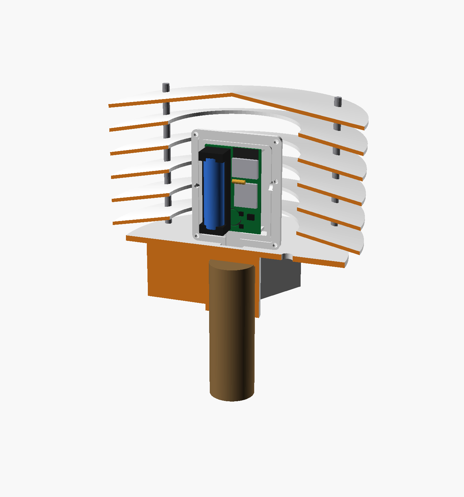
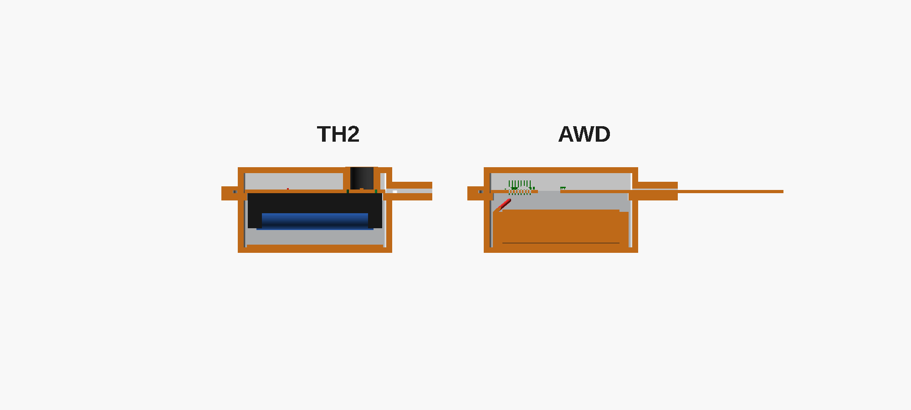
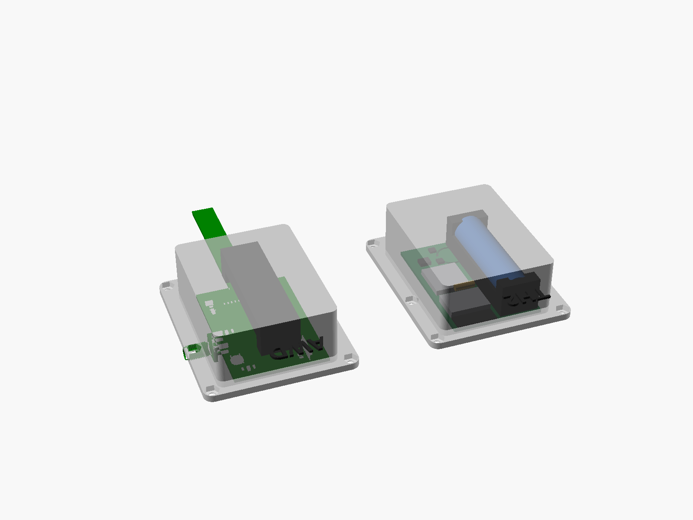

# TH2 enclosure concept v0.3: common AWD/TH box (tentative)

There is **one 40 × 60 mm PCB** in the **same box as the AWD node**. `th2_enclosure.scad` doesn't copy the AWD shells: it **calls** `front_shell()` and `back_shell()` from `products/AWD1-paddy/hardware/AWD-FieldNode/enclosure/awd_enclosure.scad` (through OpenSCAD `use`), so a change to the AWD box shows up here automatically.



| View | File |
|---|---|
| Outside: shield, base, pole | `img/assembly.png` |
| Cutaway (half the shield and the back shell removed) | `img/cutaway.png` |
| Box opened (back shell + PCB + TH front shell) | `img/box_open.png` |
| PCB top side (ESP32-C3, SX1262, 14500 holder) | `img/pcb_top.png` |
| PCB back side (SHT40 in its foam pocket, button, LEDs) | `img/pcb_back.png` |
| AWD vs TH in the same box | `img/compare_section.png`, `img/compare_underside.png` (from `compare_awd_th.scad`) |

## What is common and what is TH-only

| Part | AWD | TH |
|---|---|---|
| Back shell (deep, 23 mm) | Battery cradle, J3 | Same part. The TH PCB's top side (all parts plus the AA holder) faces into it |
| Front shell (8.6 mm) | Button membrane + LED window | **Same part, plus one 10 mm vent over the SHT40**, with an adhesive ePTFE membrane on the outside |
| PCB ledge, 6 × M3 screws, silicone groove | ✓ | ✓ (same 40 × 60 outline and the same corner posts) |
| Button / LED positions | (5, −14) / (30.5, −18.5) | **Same.** SW1 and D2/D3 sit on the TH PCB's back side right under them |
| Side hole at Y = −25 | SMA antenna | Round magnetic charging socket, or a plug (TH2-L uses a spring antenna inside the box) |
| Bottom gland boss | Strip exit into the tube collar | Drops into the TH base socket (plugged) |
| Base | Tube collar (`pipe_collar`) | **Pole base**: 32 mm (1") socket, printed sleeves for 25 / 20 mm, hose-clamp slots for bamboo, and 3 × M5 rods for the shield |

## AWD vs TH packaging in the common box

`compare_awd_th.scad` puts the AWD head (the real routed board, `ref/pcba.stl`) and the TH board in the same AWD shells.

| Section at X = 20 (`img/compare_section.png`) | Seen from below, back shells ghosted (`img/compare_underside.png`) |
|---|---|
|  |  |

| | AWD | TH2 |
|---|---|---|
| Shells, ledge, screws, gasket | AWD parts | **Same parts**. Front shell + one 10 mm vent |
| PCB | T-shaped, **4-layer**: 40 × 60 head + 10 × 300 strip out through the gland | **2-layer**, 40 × 60 head only |
| Component side faces | **Front** shell (8.6 mm; tallest part is the SMA, 5.9 mm) | **Back** shell (23 mm; tallest is the AA holder, about 14–15 mm) |
| Other PCB face | J3 battery JST (6 mm) toward the back shell | SHT40 + C12, SW1, D2/D3 toward the front shell |
| MCU / radio | ESP32-S3-MINI-1 + SX1262, SMA antenna on a pole | ESP32-C3-WROOM-02 (+ SX1262 option), spring antenna inside |
| Battery | LiFePO4 14500 in a **wired 1×AA holder, taped into the back-shell cradle**, JST to J3 | **The same cell** in a 1×AA holder **soldered on the PCB**. The cradle is unused (about 5 mm clear below the holder) |
| Charging | Cell taken out and charged externally (no charger on the board) | On-board CN3058E via the magnetic socket; the box stays shut |
| Button / LED | Under the membrane / window, on the component side | Same X/Y, on the back side |
| Side hole (Y = −25) | SMA barrel | Magnetic charging socket |
| Bottom gland | Strip exit into the tube collar | Into the pole base socket (no strip) |
| Mounting | Tube collar on the AWD pipe rim, in open sun | Pole base, box shaded inside the plate shield |

Common spares: shells, screws, gasket, membrane, and the **14500 cell**.

## Sensor pocket (keeping the SHT40 honest)

- **Placement:** the SHT40 is at the **bottom** of the upright box, (20, −50), well away from the charger and LDO. A milled slot with two bridges isolates it thermally.
- **Pocket:** a 16/10 mm foam ring seals it against the front shell, so the SHT40 sees outside air through the vent and membrane, not the box interior.
- **Firmware rules:**
  - drop readings while VBUS is present (charging);
  - drop readings for about 2 minutes after a WiFi or LoRa transmission;
  - sample with the C3 freshly woken.

## Dimensions (concept values)

| Item | Value |
|---|---|
| Box | AWD shells: 64 × 80 × 37 mm across the flanges, plus the 10 mm gland |
| Shield | 5 rings + a solid roof, OD **180**, ring opening **92** (clears the box's 64 × 37 cross-section), 17 mm pitch, 9 mm droop, 3 × M5 SS rods at R 72 |
| Battery | LiFePO4 14500 (about 600 mAh) in a Keystone 2460-class 1×AA PCB holder. Check the pin spacing of the clone you buy |

## Known issues to check on the first prototype

- **WiFi antenna next to the AA cell:** the WROOM-02 antenna sits about 2 mm from the cell's side. Expect a few dB lost. Measure RSSI against a bare module before freezing the layout.
- **TH front shell = AWD front shell + vent:** the vent can be a drilled hole on the same mould, or a mould insert.
- **Shield cost:** a 180 mm shield is bigger (and dearer) than the 120 mm one in the pipe concept. White PP plant saucers (about 200 mm) with the centre cut out remain the low-cost option.

Superseded: the pipe-sled concept is in `archive/` (`th2_pipe_concept_v0.2.scad`, `img_pipe_v0.2/`).

## Regenerate

```bash
openscad -D 'view="cutaway"'  --preview --imgsize=1400,1500 --camera=0,0,40,70,0,200,700 --viewall --autocenter --colorscheme=Tomorrow -o img/cutaway.png th2_enclosure.scad
openscad -D 'view="assembly"' --preview --imgsize=1400,1500 --camera=0,0,40,70,0,30,700  --viewall --autocenter --colorscheme=Tomorrow -o img/assembly.png th2_enclosure.scad
openscad -D 'view="pcb"'      --preview --imgsize=1400,1200 --camera=0,0,0,40,0,200,300  --viewall --autocenter --colorscheme=Tomorrow -o img/pcb_top.png th2_enclosure.scad
```
